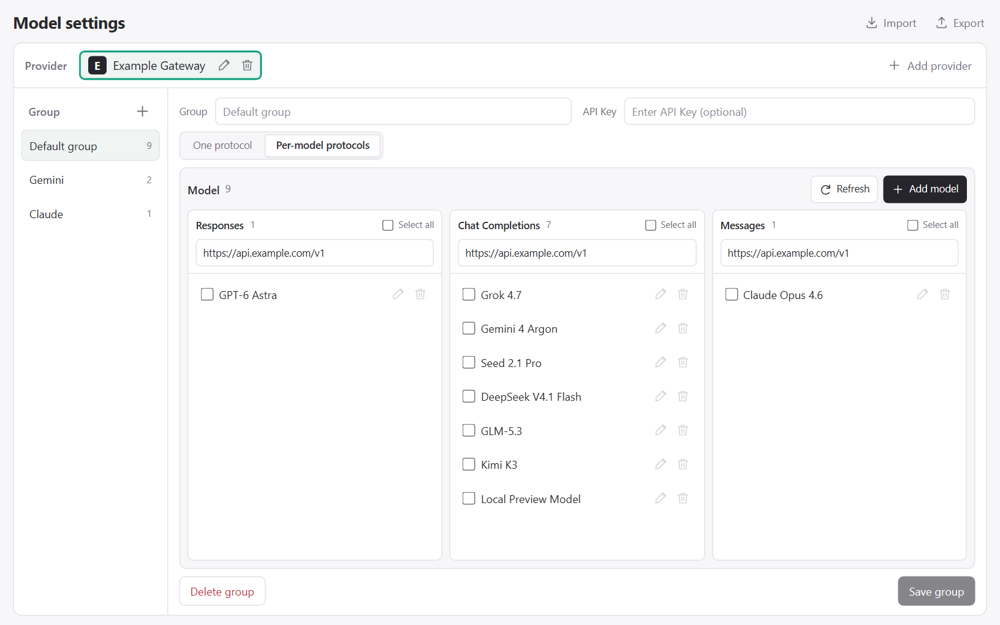

# BYOK Studio

English | [简体中文](README.zh-CN.md)

A visual editor for Copilot's **Custom Endpoint** providers, key groups, and model presets in `chatLanguageModels.json`.



## Configuration

- **Providers & key groups** — Organize multiple groups under one provider, each with its own API key, endpoint URLs, protocol mode, and model list.
- **Protocol routing** — Configure **Chat Completions**, **Responses**, or **Messages**, either shared across a group or assigned per model.
- **Model presets & parameters** — Sync presets online from [models.dev](https://models.dev) with local caching, and customize display names, Context, Output, capabilities, and reasoning levels in **Model settings** ([parameter sources and matching rules](docs/SOURCES.md)).

Context and Output map directly to `contextWindow` and `maxOutputTokens` in `chatLanguageModels.json`. Saving a group strips retired `maxInputTokens`, `zeroDataRetentionEnabled`, and `statefulResponses` fields from that group while leaving other groups untouched.

## Usage

Requires **VS Code 1.145+** and **GitHub Copilot Chat**.

1. Run **BYOK Studio: Manage Models** from the Command Palette (or click the **key icon** to the left of the Copilot icon in the status bar when enabled).
2. Add a provider, use **Add group** (`+`) on the left when separating multiple API keys or endpoints, and choose **One protocol** or **Per-model protocols**.
3. In the model list, click **Refresh** to discover models or **Add** to configure one manually, then adjust model settings as needed.
4. Click **Save** (or press `Ctrl+S` / `Cmd+S`) to update `chatLanguageModels.json` and refresh Copilot Chat's model picker.

To show a quick-access key icon in the VS Code status bar, enable **BYOK Studio: Show Status Bar Item** (`byokStudio.showStatusBarItem`) in VS Code Settings. It is disabled by default and takes effect immediately.

### Groups & native mapping

Opening the management panel reads `customendpoint` entries directly from `chatLanguageModels.json`. Starting VS Code, opening the panel, or reading configuration never writes model configuration; only explicit save, import, or delete actions modify the corresponding entries.

Each Studio group maps to one native `customendpoint` group: the default group keeps the provider name, and named groups appear as **Provider · Group**. Use the edit and delete icons on the active provider tab to rename a provider inline or remove the provider with all its groups and saved keys. **Delete** at the bottom of the group panel removes only the current group. Switching providers or groups preserves unsaved drafts, model selections, and scroll positions. Because renaming a provider or group changes native model IDs, VS Code treats renamed models as new entries (current selection, hidden, and pinned states need to be set again).

### Protocols & model management

- **One protocol** applies a single protocol and Base URL to every model in the group.
- **Per-model protocols** routes GPT / OpenAI (including Codex) to **Responses**, Claude to **Messages**, and remaining models to **Chat Completions** by default. Reassign protocols individually in **Model settings**, or select models and move them across columns; switching modes preserves manual assignments.
- **Refresh** keeps the provider's models whose IDs match text chat entries in the models.dev catalog. It replaces the draft list in discovery order and assigns protocols by model family, keeping custom names, token overrides, and reasoning settings for matching IDs. If the catalog is unavailable or no models match, the current list stays in place.
- Selecting models reveals batch **Delete** next to **Refresh** (with **Select all** on unified lists and protocol columns). Model deletions stay in the draft until the group is saved.

### Import, export & official JSON

- **Export** packages selected providers (all selected by default) with nested groups and saved plaintext API keys to the clipboard or a JSON file.
- **Import** reads from the clipboard or a JSON file and updates matching providers and groups by ID or name. Version 2 bundles, legacy version 1 exports, and raw `customendpoint` arrays are all supported.
- **BYOK Studio: Open Official Model Configuration** opens the underlying JSON, where credentials are stored as protected key references. If a native VS Code edit replaces a key reference or strips Studio metadata, the group remains readable as a standalone provider—re-enter its API key in Studio and save if needed.

<details>
<summary>Configuration example</summary>

```json
[
  {
    "name": "Example Gateway · Gemini",
    "vendor": "customendpoint",
    "byokStudioId": "demo-group-gemini",
    "byokStudioProviderId": "demo-provider",
    "byokStudioProviderName": "Example Gateway",
    "byokStudioGroupName": "Gemini",
    "models": [
      {
        "id": "gemini-4-argon",
        "name": "Gemini 4 Argon",
        "url": "https://api.example.com/v1/chat/completions",
        "apiType": "chat-completions",
        "toolCalling": true,
        "vision": true,
        "contextWindow": 1048576,
        "maxOutputTokens": 65536,
        "thinking": true,
        "supportsReasoningEffort": ["low", "medium", "high"]
      }
    ]
  }
]
```

</details>

## Development

Run `node scripts/preview-ui.cjs` to preview the UI with in-memory storage.

- `src/` — extension host, JSONC persistence, discovery, and catalog sync
- `resources/` — webview UI, localization, and shared routing logic
- `scripts/` — local UI preview harness and service regression tests
- `docs/` — screenshots and model parameter documentation

```powershell
npm ci
npm test
npm run package
```

## License

[MIT](LICENSE).
