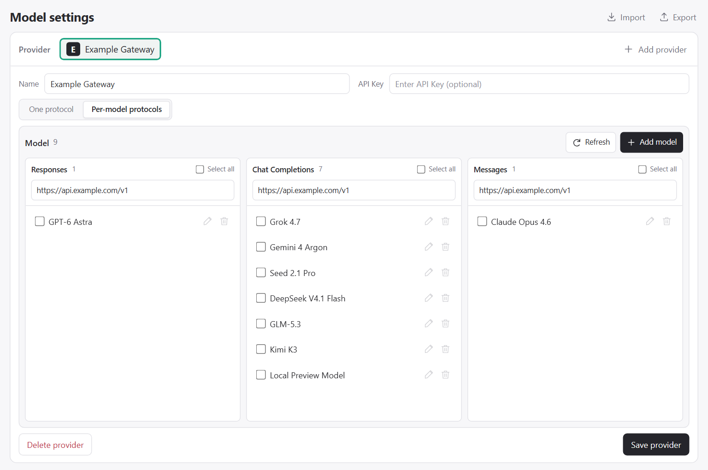

# BYOK Studio

English | [简体中文](README.zh-CN.md)

A visual editor for Copilot's **Custom Endpoint** configuration in `chatLanguageModels.json`.



## Configuration

- Provider names, endpoint URLs, and API keys.
- **Chat Completions**, **Responses**, or **Messages** protocol settings, shared by all models or assigned per model.
- Model lists, display names, token limits, capability declarations, and reasoning defaults.

[Parameter sources](docs/SOURCES.md)

## Usage

Requires **VS Code 1.145+** and **GitHub Copilot Chat**.

1. Run **BYOK Studio: Manage Models** from the Command Palette.
2. Add a provider and enter its URL, API key, and protocol settings.
3. Refresh or manually add models and adjust their settings.
4. Click **Save provider** to write the configuration. Select the corresponding **Custom Endpoint** model in Copilot Chat.

<details>
<summary>Configuration example</summary>

```json
[
  {
    "name": "Example Gateway",
    "vendor": "customendpoint",
    "byokStudioId": "demo-provider",
    "models": [
      {
        "id": "kimi-k3",
        "name": "Kimi K3",
        "url": "https://chat.example.com/v1/chat/completions",
        "apiType": "chat-completions",
        "toolCalling": true,
        "vision": true,
        "maxInputTokens": 917504,
        "maxOutputTokens": 131072,
        "thinking": true,
        "supportsReasoningEffort": ["low", "high", "max"],
        "modelOptions": { "top_p": 0.95 }
      }
    ]
  }
]
```

</details>

## Development

- `src/` — extension and configuration logic
- `resources/` — webview, shared modules, and runtime catalog
- `scripts/` — development tools and catalog maintenance
- `test/` — regression tests
- `docs/` — screenshots and parameter sources

```powershell
npm ci
npm test
npm run package
```

## License

[MIT](LICENSE).
