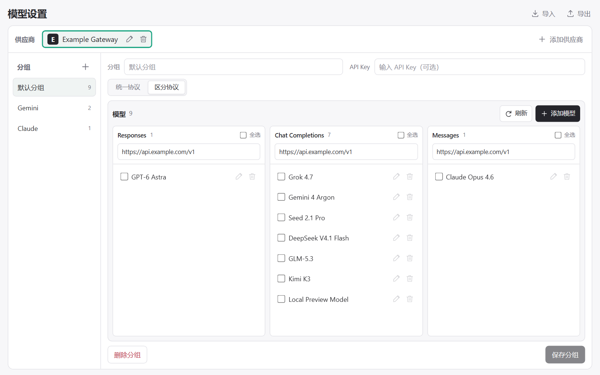

# BYOK Studio

[English](README.md) | 简体中文

用于编辑 `chatLanguageModels.json` 中 Copilot **Custom Endpoint** 供应商、多密钥分组与模型预设的可视化管理器。



## 配置内容

- **供应商与多分组** — 同一供应商下可创建多个分组，各自维护独立的 API Key、端点地址、协议模式和模型列表。
- **协议路由** — 支持 **Chat Completions**、**Responses** 和 **Messages**，可按分组统一配置或按模型独立分配。
- **模型预设与参数** — 在线同步 [models.dev](https://models.dev) 预设并在本地缓存，可在 **模型设置** 中调整显示名称、Context、Output、能力声明与推理档位（[参数来源与匹配规则](docs/SOURCES.md)）。

Context 和 Output 直接写入官方 JSON 的 `contextWindow` 和 `maxOutputTokens`。保存分组时会清理该分组旧模型中的 `maxInputTokens`、`zeroDataRetentionEnabled` 和 `statefulResponses`；未操作的分组保持不变。

## 使用

需要 **VS Code 1.145+** 和 **GitHub Copilot Chat**。

1. 在命令面板执行 **BYOK Studio: 管理模型**（启用状态栏入口后，也可直接点击底部状态栏 Copilot 图标左侧的 **钥匙图标**）。
2. 添加供应商；需要拆分多个 API Key 或端点地址时，点击左侧 **添加分组**（`+`），并选择 **统一协议** 或 **区分协议**。
3. 在模型列表中，点击 **刷新** 自动拉取模型或点击 **添加** 手动录入，按需调整模型参数。
4. 点击 **保存**（或按 `Ctrl+S` / `Cmd+S`）写入 `chatLanguageModels.json` 并刷新 Copilot Chat 模型列表。

如需在 VS Code 底部状态栏显示快捷入口，可在设置中开启 **BYOK Studio: Show Status Bar Item**（`byokStudio.showStatusBarItem`），默认关闭且更改后立即生效。

### 分组与原生映射

打开管理面板时直接读取 `chatLanguageModels.json` 中的 `customendpoint` 分组。启动 VS Code、打开面板或读取配置均不会写入模型配置；只有显式保存、导入或删除操作才会修改对应配置。

每个 Studio 分组对应一个原生 `customendpoint` 分组：默认分组沿用供应商名称，命名分组显示为 **供应商 · 分组**。通过当前供应商标签旁的编辑与删除图标可内联重命名供应商，或连同其全部分组与已存密钥一并删除。分组面板底部的 **删除** 仅移除当前分组。切换供应商或分组会保留未保存草稿、模型勾选与滚动位置。由于重命名供应商或分组会改变原生模型标识，VS Code 会将其视为新模型，当前模型选择、隐藏与固定状态需重新设置。

### 协议分配与模型管理

- **统一协议** 下分组内所有模型共用同一协议与 Base URL。
- **区分协议** 下默认按模型系列归类：GPT / OpenAI 系列（含 Codex）归入 **Responses**，Claude 归入 **Messages**，其余归入 **Chat Completions**。可在 **模型设置** 中单独调整，或勾选模型后批量移动到其他协议列；切换模式保留已有的手动分配。
- **刷新** 仅保留供应商返回且 ID 匹配 models.dev 目录的文本聊天模型。刷新按发现顺序替换草稿列表、按模型系列分配协议，并保留同 ID 模型的自定义名称、Token 覆盖和推理设置。目录不可用或没有匹配模型时，保留当前列表。
- 勾选模型后，**刷新** 左侧出现批量 **删除**（支持统一列表或单协议列 **全选**），删除操作在保存分组后生效。

### 导入、导出与官方配置

- **导出** 按供应商打包（默认全选）嵌套分组与已保存的明文 API Key，可复制到剪贴板或保存为 JSON 文件。
- **导入** 支持从剪贴板或 JSON 文件读取，按 ID 或名称匹配更新供应商与分组，兼容 v2 多分组导出、旧版 v1 导出及原生 `customendpoint` 数组。
- 执行 **BYOK Studio: 打开官方模型配置** 可查看生成的 JSON（官方配置中仅写入受保护的密钥引用）。若在 VS Code 原生界面更新密钥或移除了扩展元数据，该分组仍可作为独立供应商读取，必要时在 Studio 中重新填写 API Key 保存即可。

<details>
<summary>配置示例</summary>

```json
[
  {
    "name": "Example Gateway · Gemini",
    "vendor": "customendpoint",
    "byokStudioId": "demo-group-gemini",
    "byokStudioProviderId": "demo-provider",
    "byokStudioProviderName": "Example Gateway",
    "byokStudioGroupName": "Gemini",
    "models": [
      {
        "id": "gemini-4-argon",
        "name": "Gemini 4 Argon",
        "url": "https://api.example.com/v1/chat/completions",
        "apiType": "chat-completions",
        "toolCalling": true,
        "vision": true,
        "contextWindow": 1048576,
        "maxOutputTokens": 65536,
        "thinking": true,
        "supportsReasoningEffort": ["low", "medium", "high"]
      }
    ]
  }
]
```

</details>

## 开发

运行 `node scripts/preview-ui.cjs` 可预览界面，数据仅保存在内存。

- `src/` — 扩展宿主、JSONC 持久化、模型发现与目录同步
- `resources/` — Webview 界面、本地化与共享路由逻辑
- `scripts/` — 本地界面预览与服务层回归测试
- `docs/` — 界面截图与参数来源说明

```powershell
npm ci
npm test
npm run package
```

## 许可证

[MIT](LICENSE)。
