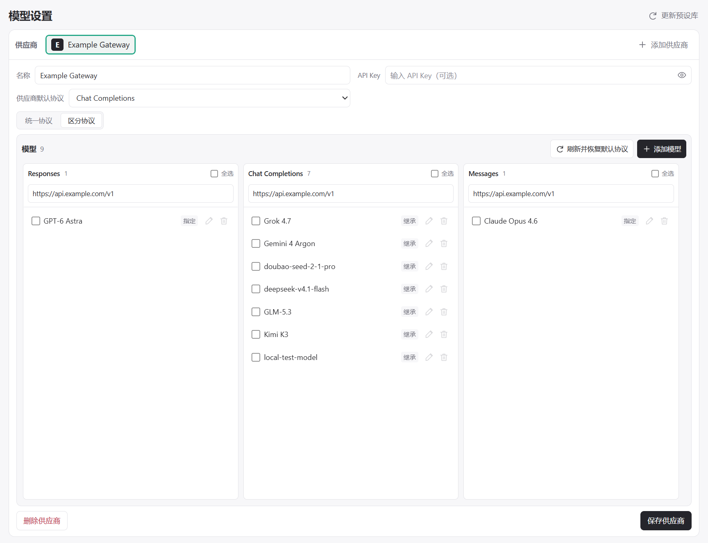

# BYOK Studio

[English](README.md) | 简体中文

用于编辑 `chatLanguageModels.json` 中 Copilot **Custom Endpoint** 配置的可视化管理器。



## 配置内容

- 供应商名称、端点地址和 API Key。
- **Chat Completions**、**Responses** 或 **Messages** 协议配置，可统一设置或按模型分配。
- 模型列表、显示名称、Token 限制、能力声明和默认推理档位。

模型预设来自 [models.dev](https://models.dev)，可在参数库中点击 **更新参数库**，保留手动修改。[参数来源](docs/SOURCES.md)。

## 使用

需要 **VS Code 1.145+** 和 **GitHub Copilot Chat**。

1. 在命令面板执行 **BYOK Studio: 管理模型**。
2. 添加供应商，填写地址、API Key 和协议配置。
3. 刷新或手动添加模型，调整设置。
4. 点击 **保存供应商** 写入配置，然后在 Copilot Chat 中选择对应的 **Custom Endpoint** 模型。

<details>
<summary>配置示例</summary>

```json
[
  {
    "name": "Example Gateway",
    "vendor": "customendpoint",
    "byokStudioId": "demo-provider",
    "models": [
      {
        "id": "kimi-k3",
        "name": "Kimi K3",
        "url": "https://chat.example.com/v1/chat/completions",
        "apiType": "chat-completions",
        "toolCalling": true,
        "vision": true,
        "maxInputTokens": 917504,
        "maxOutputTokens": 131072,
        "thinking": true,
        "supportsReasoningEffort": ["low", "high", "max"],
        "modelOptions": { "top_p": 0.95 }
      }
    ]
  }
]
```

</details>

## 开发

- `src/` — 扩展与配置逻辑
- `resources/` — 页面、共享模块及运行时参数库
- `scripts/` — 开发工具与参数库维护资料
- `test/` — 回归测试
- `docs/` — 截图与参数来源

```powershell
npm ci
npm test
npm run package
```

## 许可证

[MIT](LICENSE)。
